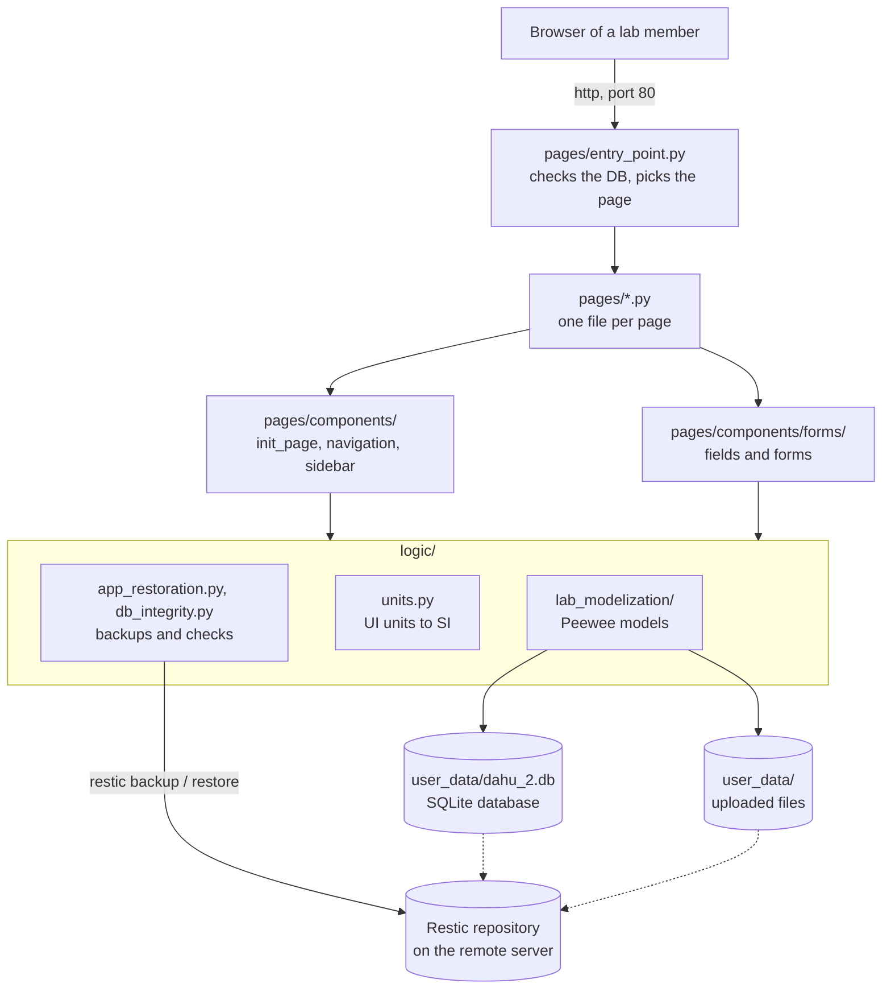

# Dahu DB

This README is for the people who maintain the app: physicists who write
Python but are not software engineers. Software-engineering words are
explained the first time they appear, and all of them are collected in the
[Glossary](#9-glossary) at the end.

**The most important rule: `user_data/` holds all the data of the app**
(the database file `user_data/dahu_2.db` and every uploaded file). Never
delete, overwrite or edit it without making a copy first, and never point
a development copy of the app at the production files.

## Contents

1. [What Dahu DB is](#1-what-dahu-db-is)
2. [Repository layout](#2-repository-layout)
3. [Setting up and running](#3-setting-up-and-running-the-app)
4. [Architecture in 5 minutes](#4-architecture-in-5-minutes)
5. [The data model and units](#5-the-data-model-and-units)
6. [Backups, restore, checks](#6-backups-restore-and-integrity-checks)
7. [Recipes](#7-recipes)
8. [Common mistakes](#8-common-mistakes)
9. [Glossary](#9-glossary)

## 1. What Dahu DB is

Dahu DB is the web app of the thin-film deposition lab of Institut Néel
(CNRS). Lab members use it from their browser to record:

- sputtering **targets**, with dated photos of their wear
  ("deterioration states") and the patches placed on them;
- **substrates** and their layers;
- **libraries** and their **films**: the deposited layers, the targets
  used and the sputtering parameters (magnetron or triode);
- **film modifications**: annealings and etchings (ion beam, wet,
  lift-off), with the etching patterns and recipes;
- **characterizations**: each
  has its data file (HDF5 for EDX), and a library can also reuse a
  measurement made on another film made with the same targets;
- uploaded files attached to all of the above.

It is written in Python with [Streamlit](https://streamlit.io) (the
library that turns a Python script into a web page) and
[Peewee](https://docs.peewee-orm.com) (the library that stores Python
objects in an SQLite database, a database kept in one ordinary file).

It runs on one desktop PC in a room of the lab, on the lab's internal
network, and users reach it at the address set in `DOMAIN` in
[`dahu_2_config.py`](dahu_2_config.py). Every hour or so it backs up
`user_data/` to a repository on a remote server with
[Restic](https://restic.net), a backup program (see
[section 6](#6-backups-restore-and-integrity-checks)).

The app used to be called "Dahu 2". Write "Dahu DB" in prose; the code
still says `dahu_2` (`dahu_2.db`, `dahu_2_config.py`...), and renaming
those would break existing installations.

## 2. Repository layout

The repository root (the top folder of the project) contains:

- [`pages/`](pages/README.md): one Python file per web page, plus
  `entry_point.py`, the script Streamlit starts.
  - [`pages/components/`](pages/components/README.md): UI code shared by
    several pages (page start-up, navigation, sidebar).
  - [`pages/components/forms/`](pages/components/forms/README.md): every
    input form, one package (subfolder) per kind of object.
- [`logic/`](logic/README.md): everything that does not draw the page:
  data model, units, backups, checks, page list, constants.
  - [`logic/lab_modelization/`](logic/lab_modelization/README.md): the
    data model, one class per database table, and the allowed values of
    text columns.
  - [`logic/migrations/`](logic/migrations/README.md): scripts run by hand
    to create the database or change its tables.
- [`.streamlit/`](.streamlit/README.md): Streamlit's settings
  (`config.toml`): port, upload limit, colours, fonts.
- `static/`: font files (Inter, JetBrains Mono) and their licences, used
  by `.streamlit/config.toml`.
- [`dev_tools/`](dev_tools/README.md): tools for developers, not part of
  the app (`check_docs.py`).
- `dahu_2_config.py`: settings you edit by hand: domain, Restic
  repository and password, paths, backup and check intervals,
  `APP_VERSION`.
- `user_data/`: **the data**, `dahu_2.db` and every uploaded file. Not in
  git.
- `.gitignore`: files git must not track (`user_data/`, `.venv/`,
  `.idea/`...).
- `.venv/`: the virtual environment (Python and the libraries), created
  on each machine. Not in git.
- `.idea/`: PyCharm's project settings. Not in git.
- `CLAUDE.md`: instructions for Claude Code, the AI assistant used on
  this project; a dense summary of the conventions.
- `sandbox.py`: a scratch file for trying out Python. Not part of the app.
- `README.md`: this file.

Every folder of the app has its own `README.md` describing each file in it
and the common tasks done there. This README links to them instead of
repeating them.

## 3. Setting up and running the app

### Prerequisites (both machines)

- **Windows**: the app and its settings assume it (Windows paths,
  environment variables).
- **Python 3.14 or later.** The code uses syntax that only exists since
  Python 3.14: `except IndexError, AttributeError:` without parentheses,
  and class annotations naming classes defined further down the file.
  Older Pythons refuse to run it.
- **git**, to download and update the code.
- **Restic**, on the `PATH` (the list of folders Windows searches for
  programs). Install it with
  `winget install --exact --id restic.restic --scope Machine`. Check with
  `restic version` in a new terminal.

### Set up a development machine

Never develop against the production files: work on copies of the
database and of the Restic repository.

1. Download the code and create the virtual environment (an isolated
   copy of Python with its own libraries, in the `.venv` folder):

   ```powershell
   git clone https://github.com/camillerahi57/dahu-2.git
   cd dahu-2
   py -3.14 -m venv .venv
   .venv\Scripts\activate
   pip install -r requirements.txt
   ```

   `requirements.txt` (the list of libraries with their exact versions)
   is not in the repository yet. Until it is, ask for the output of
   `pip freeze` on a working machine, or install the libraries named in
   the error messages one by one. If PowerShell refuses to run
   `activate`, see [Common mistakes](#8-common-mistakes).
2. **Get a dev copy of the data.** Copy the production `user_data/`
   folder (or at least `user_data/dahu_2.db`) into your clone's
   `user_data/` folder. Never copy it back to production.
3. **Get a dev copy of the Restic repository.** Copy the whole production
   repository folder (the production `RESTIC_REPO_PATH`) to a folder of
   your machine. A copied repository works as is, with the same password.
   This way backups made by your dev app never touch the production
   backups. Copy it while the production app is not backing up (backups
   start at most once an hour, see
   [section 6](#6-backups-restore-and-integrity-checks)).
4. **Edit the development block of `dahu_2_config.py`** (the `else:`
   branch): `RESTIC_REPO_PATH` = your copy of the repository,
   `RESTIC_PASSWORD` = its password, `DAHU_2_CODE_BASE_PATH` = the absolute
   path of your clone. The block currently holds the paths of the last
   developer's machine.
5. **Set the environment variables** (see below), with
   `dahu_db_production_mode` = `False`.
6. Run the app (see [Run the app](#run-the-app)) and check that
   <http://localhost> opens.

### Environment variables

An environment variable is a named value that Windows gives to every
program it starts. The app reads two of them, both required:

- **`dahu_db_production_mode`**: `True` on the production PC, `False`
  everywhere else. Any other value, or a missing variable, stops the app
  at start-up. It selects the production or development block of
  `dahu_2_config.py` (`ON_PRODUCTION` in `logic/global_variables.py`).
  The migration scripts need it too.
- **`dahu_admin_password`**: the password asked by the admin page before
  restoring a backup. It is not stored in the repository; ask the person
  in charge of the app for it.

Set them for your Windows account, either in "Edit environment variables
for your account" (Windows search), or in PowerShell:

```powershell
setx dahu_db_production_mode False
setx dahu_admin_password "<the password>"
```

`setx` only affects programs started afterwards: open a new terminal (and
restart PyCharm) before running the app.

### Run the app

From the repository root, with the virtual environment active:

```powershell
python -m streamlit run pages/entry_point.py
```

The app answers at <http://localhost> (port 80, set in
`.streamlit/config.toml`). Stop it with Ctrl+C in the terminal.

Why this exact command:

- **`python -m streamlit`, not `streamlit`.** The code imports modules
  from two folders: the repository root (`logic`, `dahu_2_config`) and
  `pages/` (`components`). Python only finds modules in the folders of its
  "import path" (`sys.path`). Streamlit adds the folder of the main script
  (`pages/`), and `python -m` adds the current folder (the root). The bare
  `streamlit run ...` launcher does not add the root, and fails with
  `No module named 'logic'`. PyCharm's run configuration adds both folders
  itself.
- **From the repository root.** The paths to the database and to
  `user_data/` (`DB_PATH`, `USER_DATA_PATH` in `logic/constants.py`) are
  relative to the current folder, and Streamlit reads
  `.streamlit/config.toml` from the current folder too.

Opening a page may start a Restic backup and the periodic problem check
(see [section 6](#6-backups-restore-and-integrity-checks)), so Restic must
work even in development.

### Set up the production PC (fresh install only)

These steps create an empty database. To update an existing installation,
follow [Release a new version](#release-a-new-version) instead.

1. Install the [prerequisites](#prerequisites-both-machines), clone the
   repository and create the virtual environment as on a dev machine.
2. Set the environment variables, with `dahu_db_production_mode` =
   `True`.
3. Create the Restic repository on the backup server. A Restic repository
   is not an ordinary folder you can browse: it stores the snapshots
   (backups) in a compressed, deduplicated format, accessed only through
   the `restic` command:

   ```powershell
   restic init --repo O:\path\to\backup\folder
   ```

   It asks for a password twice. The original setup used the dummy
   password `no_password`. **If you lose the password, the backups cannot
   be read.**
4. Fill in the production block of `dahu_2_config.py`: `DOMAIN` (the host
   name and port users type, also the beginning of every link the app
   builds), `RESTIC_REPO_PATH`, `RESTIC_PASSWORD` and
   `DAHU_2_CODE_BASE_PATH` (absolute path of the clone on this PC).
5. Create the `user_data` folder at the repository root, then create the
   tables:

   ```powershell
   python -m logic.migrations.table_creation
   ```

   **This script also deletes every snapshot of the Restic repository set
   in `dahu_2_config.py`.** Run it only on a fresh install with a new
   repository, never on an existing installation. See
   [`logic/migrations/README.md`](logic/migrations/README.md).
6. [Run the app](#run-the-app) and open it from another computer of the
   lab network.

To work on the production PC from your own computer, use Windows' Remote
Desktop. (The PC used originally was named `DESKTOP-QFQ4PL0`.)

## 4. Architecture in 5 minutes



Pages also use `logic/` directly (to load objects, save them, find other
pages). Settings come from `dahu_2_config.py` and the environment
variables.

**What happens when someone opens a page:**

1. Streamlit runs `pages/entry_point.py` from the top. It checks that the
   database file exists and has tables, then `st.navigation` runs the page
   file matching the URL (the libraries table when there is none). Every
   page must be listed in `logic/page_list.py`.
2. The page first calls `init_page` (`pages/components/general.py`), which
   starts a backup or the problem check when one is due, draws the Home
   button, and clears the page's leftover state when the user comes from
   another page.
3. The page finds the object to show in the URL's query parameters (the
   `?lib_id=3` part; the names come from `IdType` in `logic/constants.py`),
   loads it from the database and draws it.
4. A form page draws a form built from `pages/components/forms/`. Each
   field converts what the user types into SI units. On Submit, the page
   saves the object and its parts in one transaction (a group of database
   writes that all succeed or are all cancelled).
5. **Every click reruns the page script from the top** (a Streamlit
   "rerun"). Values that must survive a rerun are kept in the session
   state (`st.session_state`, a dictionary Streamlit keeps for each browser
   tab), and choices that must survive closing the browser (filters, last
   email used) are kept in cookies (small texts stored by the browser).

In production, an error raised by a page is shown on the page instead of
stopping the app; in development it is raised normally, with the full
traceback in the terminal.

Where to read more: [`pages/README.md`](pages/README.md) (every page),
[`pages/components/README.md`](pages/components/README.md) (start-up and
navigation), [`pages/components/forms/README.md`][forms-readme] (how
fields and forms work), [`logic/README.md`](logic/README.md).

[forms-readme]: pages/components/forms/README.md

## 5. The data model and units

### Models, tables, columns

The database has one table per **model**: a Python class in
[`logic/lab_modelization/db_models.py`](logic/lab_modelization/db_models.py)
whose objects are rows of the table and whose class attributes are its
columns. Peewee, the ORM (object-relational mapper: the library that
translates between Python objects and database rows), names each table
after its model in snake_case (`TriodeSputtering` → `triode_sputtering`).
"Model", "class" and "table" mean the same thing here, as do "attribute"
and "column".

Each model's docstring lists its columns under `Attributes:`, with their
meaning, unit and whether they can be empty (NULL). The module docstring
groups the models by topic. The conventions to know before changing a
model are in
[`logic/lab_modelization/README.md`](logic/lab_modelization/README.md);
in short:

- **Foreign keys.** A foreign key is a column holding the id of a row of
  another table (a film layer points to its film). SQLite checks that the
  row pointed to exists. The rows pointing back to a row are its
  **backref** (`film.layers`).
- **Parts.** The rows that belong to an object and are saved and deleted
  with it (the layers of a substrate, the patches of a target state). A
  form builds the object with its parts attached, unsaved, and the page
  saves everything with `save_with_dependent()`. `delete_with_parts()`
  deletes an object, its parts, and its uploaded file if any.
- **Subtypes.** The details of one kind of row live in a separate table
  linked to the general row: a `FilmLayer` has a `MagnetronSputtering` or a
  `TriodeSputtering`; a `FilmModification` has an `Annealing` or an
  `Etching`, and an `Etching` is an `IonBeamEtching`, `WetEtching` or
  `LiftOffEtching`; a `Charac` can have an `Edx`. An enum column on the
  general row says which subtype applies.
- **Enums.** A text column that takes one value from a fixed list is
  annotated with a `StrEnum` from
  [`db_enums.py`](logic/lab_modelization/db_enums.py) (an enum is a fixed
  list of named constants). The database stores the string value.
  Adding a value is safe; renaming or deleting one needs a migration.
- **Uploaded files.** Each kind of uploaded file (`Pattern`, `Recipe`,
  `LibraryFile`, `CharacFile`, `TargetPhoto`) is a model whose row holds
  the metadata, while the file itself is stored as
  `user_data/<internal_file_name>`.
- **Compositions.** Chemical formulas are stored as `StoichioElement`
  rows, one per element.
- **Logs and settings.** `AppLog` holds the event log (saves, deletions,
  backups, problems found), shown on the logs page. `AppMetadata` holds a
  single row with the backup and problem-check schedule and the version of
  the app that last saved it.
- **Every model must be defined in `db_models.py`.** The list
  `dahu_2_models` at the bottom of that file collects them automatically
  for table creation, the integrity checks and the Excel export.

### Lab concepts

- **Library and film.** Every library has exactly one film, created
  together with it. (The app enforces this; the database itself would
  allow several.) A library stands for the measurements made on its film,
  plus measurements made on another film that would give the same results
  on this one. For example, if films A and B have the same thickness, the
  thickness is measured on A only, and B's library refers to that
  measurement (`CharacReference`).
- **Target, deterioration state, patch.** A target has dated
  deterioration states, each with a photo. A patch is a piece of material
  placed on the target to obtain the wanted composition; patches are drawn
  as polygons on the state's photo.
- **Target use.** `TargetUse` links each film layer to the targets used to
  deposit it.

### Units: SI in the database, anything in the UI

**The database stores every physical quantity in SI base units** (m, s,
K, kg, A, rad and their combinations: m³/s for a flow, Pa for a pressure).
The forms show and accept other units; the conversion uses
[Pint](https://pint.readthedocs.io), a library that attaches units to
numbers (see [`logic/units.py`](logic/units.py)).

| Typed in the form | Stored in the database |
|---|---|
| 250 nm | 2.5e-07 (m) |
| 20 °C | 293.15 (K) |
| 10 SCCM (cm³/min) | 1.67e-07 (m³/s) |
| 5e-3 mbar | 0.5 (Pa) |
| 90 min | 5400 (s) |

Each form field class for a physical quantity (a `UnitField`) declares
its UI unit once, in `ui_unit` (for example `ui_unit = ur.um`). Read a
form value with `.in_db_unit`, which gives SI; `.value` raises an error on
purpose for unit fields. To display a stored value, use the field class's
`db_to_ui_str()` or `to_ui_unit()`.

Consequences:

- Changing a field's `ui_unit` changes the unit everywhere that class is
  used, including for displaying existing values, and the stored values
  stay correct. See [Change a UI unit](#change-a-ui-unit).
- The Excel export of the admin page, DataGrip and any SQL you write
  show or need SI values.
- One known exception: the triode nitrogen flow is stored as typed (see
  "nitrogen flow" in [`pages/components/forms/new_library/README.md`][nl]).

[nl]: pages/components/forms/new_library/README.md

### Attribute choices: when to add a column

For each model, we add an attribute only if it:

- must be searchable, OR
- is accessed frequently, OR
- is not stored in the uploaded files AND can change AND affects the
  measurements.

Everything else stays in the uploaded files.

## 6. Backups, restore and integrity checks

The code is in [`logic/app_restoration.py`](logic/app_restoration.py) and
[`logic/db_integrity.py`](logic/db_integrity.py); the settings are in
[`dahu_2_config.py`](dahu_2_config.py).

### Automatic backups

- A backup is a Restic **snapshot** of the whole `user_data/` folder: the
  database file and the uploaded files together. A snapshot therefore
  holds a coherent **app state** (database and files from the same
  moment). Restic only stores what changed since the previous snapshot,
  so snapshots take little space.
- There is no scheduled task: when someone opens a page and
  `BACKUP_INTERVAL` (1 hour) has passed since the last backup, `init_page`
  starts `restic backup` in a background thread (a task running at the
  same time as the page, so the page does not wait). If nobody uses the
  app, no backup is made.
- The database file is backed up as it is; it is not exported or
  "dumped" first.
- After each backup the app forgets the snapshots it no longer needs and
  frees their space (`restic forget --keep-hourly ... --prune`). The policy
  is `BackupsToKeep` in `dahu_2_config.py`: the latest snapshot of each of
  the last 8 hours, 7 days, 6 weeks, 5 months and 1 year, so at most 27
  snapshots.
- Every Restic failure writes a critical `AppLog` row, shown on the logs
  page and in the banner of the home page. (Writing it from the backup
  thread may itself fail; see the `TODO` in `Snapshot.backup`.)

### Restore from the admin page

The admin page lists the snapshots; restoring one asks for the
`dahu_admin_password`. A restore:

1. runs `restic restore <snapshot>:<user_data path> --delete`, which
   replaces the whole `user_data/` folder by the snapshot's version
   (files added since are deleted), **for every user**;
2. **deletes every snapshot taken after the restored one**, so the
   history ends at the restored state;
3. schedules the next backup one `BACKUP_INTERVAL` later.

Limits:

- Restoring a snapshot taken when the models were different (before a
  migration) may fail or give a database the current code cannot read.
  Restoring across schema changes is not supported.
- Snapshots record the absolute path of `user_data/`, and the restore
  looks for the path built from `DAHU_2_CODE_BASE_PATH`. If the code
  folder has moved since the snapshot was taken, the restore fails with
  "path ... not found". This is also why a dev app can only restore the
  snapshots it took itself, not those copied from production.

### Explore an old snapshot by hand

To look at old files without restoring anything, restore a snapshot to
another folder with the `restic` command:

```powershell
$env:RESTIC_PASSWORD = "no_password"   # the repository's password
$repo = "O:\path\to\repo"
restic snapshots --repo $repo          # pick a snapshot id
restic ls <id> --repo $repo            # find the path of user_data
restic restore <id>:/C/path/to/dahu-2/user_data --target D:\old --repo $repo
```

Inside a snapshot, Restic writes a Windows path such as
`C:\path\to\dahu-2\user_data` as `/C/path/to/dahu-2/user_data`. Copy it
from the output of `restic ls`: it must match exactly. Restoring only the
`user_data` subfolder like this avoids the access errors Windows raises
when Restic recreates the parent folders (such as `C:\Users`).

### Integrity checks

When `PROBLEM_CHECK_INTERVAL` has passed, `init_page` also runs
`get_problems()` from `logic/db_integrity.py`:

- every model's `get_problems()`: stored enum values the code no longer
  knows (only for columns annotated with a plain enum, not
  `MyEnum | None`), and uploaded files missing from `user_data/`;
- a check that the latest snapshot is younger than
  `NO_RECENT_BACKUP_WARNING_TIMEDELTA` (7 days).

Each problem becomes an `AppLog` row. The logs page lists them; the home
page shows a banner (if `SHOW_PROBLEM_BANNER` is True) until a warning is
marked read or a critical problem marked solved. To add a check, see
"Add a check to the periodic problem scan" in
[`logic/README.md`](logic/README.md).

## 7. Recipes

**There are no automated tests.** After any change, run the app on a dev
copy of the data and click through every page the change affects. Before
committing, run `git diff` and read it.

### Add a column (with its migration script)

Changing a model in `db_models.py` does not change the database file: a
**migration** script must change the existing tables, once, on every
installation. A migration is a small script that changes the structure of
the database (its **schema**) and moves the existing data into it.

1. Check the [attribute choices](#attribute-choices-when-to-add-a-column).
2. Change the model, its `__init__`, its docstring, and the forms that
   fill it: follow "Add a column to an existing table" in
   [`logic/lab_modelization/README.md`](logic/lab_modelization/README.md).
3. Write the migration script in `logic/migrations/`, named after the date
   and the change (e.g. `2026_09_split_argon_flow.py`), as described in
   the two cases below. Write it in raw SQL (`db.execute_sql`), not with
   Peewee objects and `save()`: many models write an `AppLog` row on
   every save, which needs a running Streamlit page.
4. **Test it on a throwaway copy.** Copy your dev `dahu_2.db`, run
   `python -m logic.migrations.<script>` from the repo root, check that it
   prints `Migration complete`, look at the data in DataGrip (read only),
   then run the app and click through every page that shows this table.
   If something goes wrong, put the copy back and start again.
5. Commit the script with the model change. On production it is run
   exactly once, during the [release](#release-a-new-version).

Use DataGrip (or any database browser) only to read the data: manual edits
cannot be reproduced on another copy and can leave the data incoherent.

#### Simple case: a new column that may be NULL

SQLite can add such a column in place:

```python
"""Adds `target.diameter` (m, may be NULL).

Run once, from the repo root:
python -m logic.migrations.2026_09_add_target_diameter
"""
from logic.lab_modelization.base_classes import db

db.execute_sql('ALTER TABLE "target" ADD COLUMN "diameter" REAL')
print('Migration complete')
```

A `NOT NULL` column added this way needs a `DEFAULT` value.

#### General case: change, split, rename or retype a column

SQLite cannot change a column in place, so the table is rebuilt. Example:
the triode sputtering argon flow becomes a flow (`flow`) plus the gas used
(`flow_gas`), and all existing rows get the gas `argon`.

First look up the table's current definition and its indexes on your dev
copy, in DataGrip or with these SQL queries:

```sql
SELECT sql FROM sqlite_master WHERE name = 'triode_sputtering';
SELECT sql FROM sqlite_master
    WHERE type = 'index' AND tbl_name = 'triode_sputtering';
```

Copy the `CREATE TABLE`, rename the table to `triode_sputtering_new` and
edit the columns. Peewee's column types are `REAL` (`FloatField`),
`INTEGER` (`IntegerField`, `BooleanField`, foreign keys), `VARCHAR(255)`
(`CharField`), `TEXT` (`TextField`), `DATETIME` and `DATE`. Then write
the script:

```python
"""Splits `triode_sputtering.argon_flow` into `flow` and `flow_gas`.

Run once, from the repo root:
python -m logic.migrations.2026_09_split_argon_flow
"""
from logic.lab_modelization.base_classes import db

# Must run outside a transaction: SQLite ignores it inside one.
db.execute_sql('PRAGMA foreign_keys=OFF')

with db.atomic():  # If any step fails, none of them is kept.
    db.execute_sql("""
        CREATE TABLE "triode_sputtering_new" (
            "id" INTEGER NOT NULL PRIMARY KEY,
            "has_active_cooling" INTEGER,
            "rotation_speed" REAL,
            "filament_current_start" REAL,
            "filament_current_end" REAL,
            "anode_current" REAL,
            "anode_voltage" REAL,
            "cathode_current" REAL,
            "cathode_voltage" REAL,
            "deposit_rate" REAL,
            "flow" REAL,
            "flow_gas" VARCHAR(255),
            "nitrogen_flow" REAL,
            "pressure" REAL,
            "deposit_duration" REAL,
            "presputtering_thickness" REAL,
            "film_layer_id" INTEGER NOT NULL,
            FOREIGN KEY ("film_layer_id") REFERENCES "film_layer" ("id")
                ON DELETE RESTRICT)
    """)
    db.execute_sql("""
        INSERT INTO "triode_sputtering_new" (
            "id", "has_active_cooling", "rotation_speed",
            "filament_current_start", "filament_current_end",
            "anode_current", "anode_voltage", "cathode_current",
            "cathode_voltage", "deposit_rate", "flow", "flow_gas",
            "nitrogen_flow", "pressure", "deposit_duration",
            "presputtering_thickness", "film_layer_id")
        SELECT
            "id", "has_active_cooling", "rotation_speed",
            "filament_current_start", "filament_current_end",
            "anode_current", "anode_voltage", "cathode_current",
            "cathode_voltage", "deposit_rate", "argon_flow", 'argon',
            "nitrogen_flow", "pressure", "deposit_duration",
            "presputtering_thickness", "film_layer_id"
        FROM "triode_sputtering"
    """)
    db.execute_sql('DROP TABLE "triode_sputtering"')
    db.execute_sql('ALTER TABLE "triode_sputtering_new" '
                   'RENAME TO "triode_sputtering"')
    # DROP TABLE also dropped the table's indexes: create them again.
    db.execute_sql('CREATE UNIQUE INDEX "triode_sputtering_film_layer_id" '
                   'ON "triode_sputtering" ("film_layer_id")')
    # Lists the rows whose foreign key points nowhere; there must be none.
    broken = db.execute_sql('PRAGMA foreign_key_check').fetchall()
    if broken:
        raise RuntimeError(f'Broken foreign keys: {broken}')

db.execute_sql('PRAGMA foreign_keys=ON')
print('Migration complete')
```

Why each step:

- **`PRAGMA foreign_keys=OFF`** (a pragma is an SQLite setting). With
  foreign keys checked, dropping a table that other tables point to fails
  ("FOREIGN KEY constraint failed"), or deletes the rows pointing to it if
  their foreign key says `ON DELETE CASCADE`. SQLite ignores this pragma
  inside a transaction, so it must come before `with db.atomic():`.
- **`with db.atomic():`** makes the steps a transaction: if one fails,
  the database is left as it was.
- **Recreate the indexes.** An index is a lookup table SQLite keeps to
  find rows fast, and a unique index also forbids duplicates (here, two
  triode rows for one layer). `DROP TABLE` deletes them, so copy their
  `CREATE INDEX` statements from the second query above.
- **`PRAGMA foreign_key_check`** finds rows pointing to a missing row,
  which the switched-off checks could have let through.
- Tables that point to the rebuilt table keep working: they refer to it
  by name, and the new table gets the old name and the same ids.

### Add an enum value

1. Add a member to the enum in
   [`logic/lab_modelization/db_enums.py`](logic/lab_modelization/db_enums.py).
   No migration is needed. Then grep for the enum's name and check each
   use: a select box or radio button built from the enum shows the new
   value by itself, but some fields write their choices by hand, and an
   enum that picks a subtype (such as `FilmModifType`) also needs the
   code that handles the new kind.
2. Renaming or deleting a value is different: write a migration running
   `UPDATE <table> SET <column> = 'new' WHERE <column> = 'old'` for every
   column annotated with that enum, and change the enum in the same
   commit (see [`logic/migrations/README.md`](logic/migrations/README.md)).
   Renaming only the Python name (`POLYGON = 'polygon'` →
   `POLY = 'polygon'`) is safe, since only the string is stored.

### Add a page

1. Create `pages/<name>.py`, starting with a module docstring. Copy the
   structure of [`pages/new_substrate.py`](pages/new_substrate.py): call
   `init_page(pages.<name>)` first, and wrap the body in
   `try: ... except PausePageRun: pass`.
2. Register it in [`logic/page_list.py`](logic/page_list.py): add an
   attribute to `_Pages` with
   `Page('../pages/<name>.py', url_path=..., title=..., icon=...)`.
   Streamlit refuses to start if a registered file is missing. Never change
   an existing `url_path`: saved links would break.
3. Link to it with `switch_page_bttn(pages.<name>, ...)`, putting the
   object's id in `q_params` if the page shows one object.
4. List it in [`pages/README.md`](pages/README.md).

"New" and "edit" pages have extra steps, described in
[`pages/README.md`](pages/README.md) ("Common tasks").

### Add a form field

1. Add the database column first if needed
   ([Add a column](#add-a-column-with-its-migration-script)).
2. In the form package's `fields.py`, add a class: subclass `Field` (or
   `UnitField` with a `ui_unit` for a physical quantity), set `type`
   (`MANDATORY`, `ADVISED` or `OPTIONAL`), and write `_streamlit_input`
   (draws the widget) and `_validate` (returns `(ok, message)`).
   `ThicknessField` in
   [`new_substrate/fields.py`](pages/components/forms/new_substrate/fields.py)
   is a short example.
3. In `sub_forms.py`, create the field in the form's `__init__` with
   `form_default` (value for a new object) and `db_default` (value of the
   edited object), store its value (`.in_db_unit` for a unit field,
   `.value` otherwise), and **add it to the `fields` list given to
   `super().__init__`**.
4. Pass the value to the model in the form's `to_<model>()` method.

Details and per-package instructions:
[`pages/components/forms/README.md`](pages/components/forms/README.md) and
the README of the package.

### Change a UI unit

1. Find the field class used to type the quantity (the form packages'
   `fields.py`; each docstring gives the UI and database units).
2. Change its `ui_unit` (e.g. `ur.um` → `ur.nm`). If it also sets
   `ui_unit_alias` (a text shown instead of the unit, such as `'SCCM'`),
   update it.

That's all: stored values stay in SI, so no migration is needed. The new
unit applies everywhere the class is used, including tables and plots
that display existing values.

### Release a new version

On your dev machine:

1. Bump `APP_VERSION` (an integer) in `dahu_2_config.py`. Each save of
   the `AppMetadata` row records it, so one can tell which version last
   wrote a database.
2. If you installed a new library: `pip freeze > requirements.txt`.
3. Commit your code, migration scripts and `requirements.txt`, and push:

   ```powershell
   git add <files>
   git commit -m "<what changed>"
   git push
   ```

On the production PC (through Remote Desktop):

1. Stop the running app (Ctrl+C in its terminal).
2. Make a copy of `user_data/` if the release has a migration.
3. From the repository root:

   ```powershell
   git pull
   .venv\Scripts\activate
   pip install -r requirements.txt
   ```

4. Run each new migration script **exactly once**:
   `python -m logic.migrations.<script>`.
5. Start the app again (`python -m streamlit run pages/entry_point.py`)
   and check the pages the release changed.

## 8. Common mistakes

- **Forgetting `super().__init__(fields, sub_forms)` in a form.**
  Validation then silently stops working, and Submit may be enabled for an
  invalid form. List every field and sub-form in it.
- **Two widgets with the same key.** Widget keys are
  `<class name>_<key>`. When a field class appears several times on a page
  (one per layer, per patch...), give each one a distinct `key`, usually
  its index. Some fields ignore `key` (their docstring says so) and can
  appear only once per page.
- **Importing a page file from another module** ("double page load").
  Streamlit runs a page as a script, so `import`ing it runs the whole page
  a second time inside the current one. Put shared code in
  `pages/components/` instead.
- **Using `st.switch_page` on a page whose URL has query parameters.** The
  browser's back button would then lose the parameters and break
  navigation. Always use `switch_page_bttn`, which draws an HTML link in
  that case.
- **A bare string in a page file.** In `pages/*.py`, a string anywhere
  except as the first statement of the module, a function or a class is
  displayed on the web page (Streamlit's "magic"). Use `#` comments.
- **Reading a unit field with `.value`.** It raises an error on purpose;
  use `.in_db_unit`.
- **Changing a model without a migration**, or renaming or deleting an
  enum value without updating the stored rows. The code then disagrees
  with the database file; the problem check reports unknown enum values.
- **Saving models with Peewee in a script.** Many models write an
  `AppLog` row on every save, which needs a running Streamlit page. Use
  raw SQL in scripts.
- **Running `logic/migrations/table_creation.py` on an existing
  installation.** It deletes every Restic snapshot.
- **Pointing a dev app at production files**: the production
  `user_data/`, or the production Restic repository in the development
  block of `dahu_2_config.py`.
- **Starting the app with `streamlit run` or from another folder**:
  `No module named 'logic'`, or the database is not found.
- **Changing a `CookieKeys` value or a page's `url_path`.** Browsers lose
  their saved filters, or saved links break.
- **Changing the port or the upload limit in one place only.** Both are
  set in `.streamlit/config.toml` and in `dahu_2_config.py` (see
  [`.streamlit/README.md`](.streamlit/README.md)).
- **Moving the code folder on the production PC** without updating
  `DAHU_2_CODE_BASE_PATH`: backups and restores use that path, and
  snapshots taken from the old path can no longer be restored from the
  admin page.
- **Editing the data with DataGrip.** Use it to read only.
- **PowerShell refuses to run `.venv\Scripts\activate`** ("running scripts
  is disabled on this system"). Run
  `Set-ExecutionPolicy -Scope CurrentUser RemoteSigned` once, or call
  `.venv\Scripts\python` directly instead of `python`.
- **New environment variables not seen.** Programs started before `setx`
  do not see them; open a new terminal or restart PyCharm.

## 9. Glossary

Software-engineering terms used in this README and in the folder READMEs.

- **Abstract base class / abstract method**: a class meant only to be
  subclassed; each subclass must write its abstract methods.
- **App state**: the database and the uploaded files at one moment; what a
  snapshot holds.
- **Backref**: the list of rows that point to a given row through a
  foreign key (`film.layers`).
- **Callback**: a function Streamlit calls when a widget is used, before
  rerunning the page.
- **Circular import**: two modules that each need the other to be loaded
  first; avoided by importing inside a function.
- **Class / object / subclass**: a class describes a kind of object (its
  data and functions, called methods); a subclass is a class that reuses
  and extends another one (its parent).
- **Column / row / table**: a table is like a spreadsheet; each row is one
  record and each column one attribute.
- **Commit / push / pull / clone** (git): a commit is a saved version of
  the code; push sends commits to GitHub, pull fetches them, clone
  downloads the repository the first time.
- **Cookie**: a small text the browser keeps for a website between visits.
- **Database**: here, the SQLite file `user_data/dahu_2.db`, holding the
  metadata (everything except the uploaded files).
- **Dataclass**: a class whose `__init__` Python writes from its annotated
  attributes.
- **Dialog**: a pop-up window, drawn by a function decorated with
  `@st.dialog`.
- **Docstring**: the string at the start of a module, class or function
  that documents it.
- **Enum** (`StrEnum`, `IntEnum`): a fixed list of named constants; the
  members of a `StrEnum` compare equal to plain strings.
- **Environment variable**: a named value that Windows gives to every
  program it starts.
- **Foreign key**: a column holding the id of a row of another table.
- **Generator**: a function that produces its results one by one, only
  when the caller asks for the next one.
- **Generic type**: a type with a parameter in brackets, such as
  `DependentBackref[FilmLayer]` ("a list of parts that are film layers").
- **Id / primary key**: the number that identifies a row in its table.
- **Import path** (`sys.path`): the folders where Python looks for
  modules.
- **Index**: a lookup table SQLite keeps to find rows fast; a unique index
  also forbids duplicate values.
- **Migration**: a script that changes the schema of an existing database
  and moves its data into the new structure.
- **Model**: a class whose objects are rows of one database table.
- **Module / package**: a module is one `.py` file; a package is a folder
  of modules.
- **NULL**: the database's "no value" (Python's `None`).
- **Object graph**: an unsaved object with its parts attached as lists,
  saved all at once with `save_with_dependent()`.
- **ORM** (object-relational mapper): a library that translates between
  Python objects and database rows; ours is Peewee.
- **Parts**: the rows that belong to an object and are saved and deleted
  with it.
- **PATH**: the environment variable listing the folders where Windows
  looks for programs such as `restic`.
- **Port**: the number that tells which program of a computer a network
  request is for; web pages use 80 by default.
- **Pragma**: an SQLite setting, changed with an SQL `PRAGMA` command.
- **Production / development (dev)**: the installation the lab uses / a
  copy for changing the code safely.
- **Query parameter**: a `name=value` pair at the end of a URL
  (`?lib_id=3`), telling a page which object to show.
- **Repository**: a git repository is the project folder with its version
  history; a Restic repository is the folder where Restic stores
  snapshots.
- **Rerun**: Streamlit runs the whole page script again, from the top,
  after every click or widget change.
- **Schema**: the structure of the database: its tables, columns, types
  and constraints.
- **Session state** (`st.session_state`, often `sess`): a dictionary
  Streamlit keeps for each browser tab, the way values survive reruns.
- **Singleton**: something there is only one of, such as the single
  `AppMetadata` row.
- **Snapshot**: one Restic backup of `user_data/`.
- **SQL**: the language used to query and change a database.
- **Subtype**: a separate table holding the details of one kind of
  general row, chosen by an enum column on the general row.
- **Thread**: a task running at the same time as the rest of the program.
- **Transaction**: a group of database writes that all succeed or are all
  cancelled (`with db.atomic():`).
- **User files folder**: `user_data/`, holding every uploaded or generated
  file (target photos, film measurements...) and the database.
- **Virtual environment** (`.venv`): an isolated copy of Python with its
  own libraries, so projects don't interfere.
- **Widget / widget key**: an input element on the page (button, text
  box); its key is the name Streamlit uses to recognize it from one rerun
  to the next.
